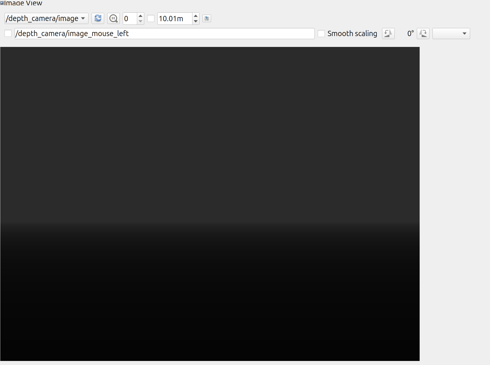
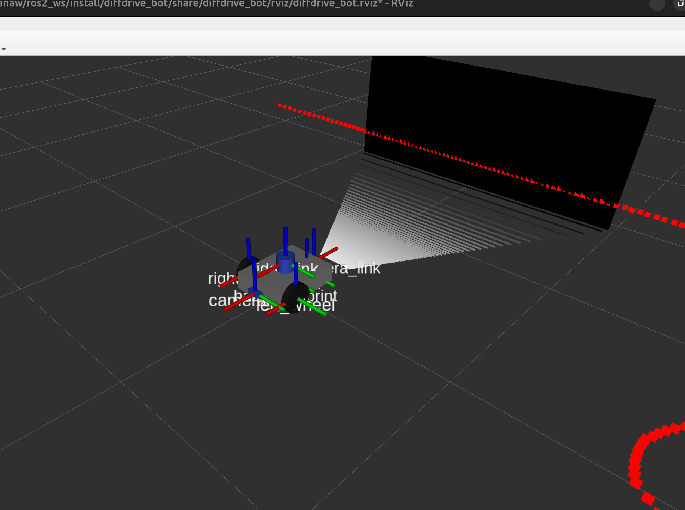
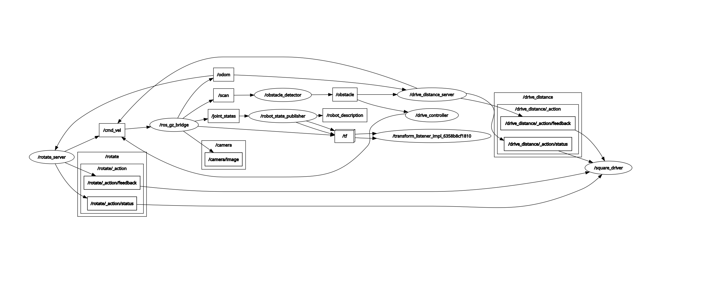

# Introduction to Robotics and Intelligent Systems — Lab 1

ROS 2 lab exercise implementing a differential-drive robot simulation, obstacle avoidance, custom ROS interfaces, action servers, and a square-driving action client.

## Packages

This repository contains four ROS 2 packages:

- `diffdrive_bot` — Differential-drive robot model, Gazebo simulation, controllers, and `DriveDistance` action.
- `lab_interfaces` — Custom messages, services, and actions used by the robot.
- `my_robot_interfaces` — Custom `RobotStatus` message, `SetTurnSpeed` service, and `Rotate` action.
- `my_robot_nodes` — Obstacle avoidance, rotation action server, and square-driving action client.

## Requirements

- Ubuntu 24.04
- ROS 2 Jazzy
- Gazebo Harmonic
- `colcon`
- Required ROS 2 dependencies for the packages

## Build

Create a ROS 2 workspace and clone this repository into its `src` directory.

```bash
mkdir -p ~/ros2_ws/src
cd ~/ros2_ws/src
git clone https://github.com/Harlov19/robotics_intelligent_systems_lab1_exercise.git
```

Source ROS 2:

```bash
source /opt/ros/jazzy/setup.zsh
```

Build the packages:

```bash
cd ~/ros2_ws
colcon build --symlink-install
```

Source the workspace:

```bash
source ~/ros2_ws/install/setup.zsh
```

If the custom Python interfaces are not available in the current terminal, source their package setup:

```bash
source ~/ros2_ws/install/my_robot_interfaces/share/my_robot_interfaces/package.zsh
```

## Step 1 — Robot simulation and sensors

Launch the robot visualization in RViz:

```bash
ros2 launch diffdrive_bot display.launch.py
```

Launch the Gazebo simulation:

```bash
ros2 launch diffdrive_bot gazebo.launch.py
```

Launch the robot control system:

```bash
ros2 launch diffdrive_bot control.launch.py
```

The robot model includes a camera, depth camera, LiDAR, and IMU.

Relevant topics include:

- `/cmd_vel`
- `/odom`
- `/scan`
- `/camera/image`
- `/depth_camera/image`
- `/depth_camera/points`
- `/imu`

## Step 2 — Obstacle avoidance

Start the simulation and control system:

```bash
ros2 launch diffdrive_bot control.launch.py
```

In another terminal, run:

```bash
ros2 run my_robot_nodes turn_away
```

The node subscribes to `/obstacle` and publishes velocity commands to `/cmd_vel`.

## Step 3 — Parameters

The `turn_away` node declares the following parameters:

- `forward_speed` — Forward velocity in m/s.
- `turn_speed` — Angular velocity in rad/s.
- `max_turn_speed` — Maximum allowed turn speed.

Example:

```bash
ros2 param set /turn_away forward_speed 0.3
```

## Step 4 — Robot status message

The custom message is:

`my_robot_interfaces/msg/RobotStatus`

It contains:

- `state`
- `obstacle_distance`

Monitor the status:

```bash
ros2 topic echo /robot_status
```

## Step 5 — Enable/disable and set turn speed

Enable obstacle avoidance:

```bash
ros2 service call /turn_away_enable std_srvs/srv/SetBool "{data: true}"
```

Disable obstacle avoidance:

```bash
ros2 service call /turn_away_enable std_srvs/srv/SetBool "{data: false}"
```

Set the turn speed:

```bash
ros2 service call /set_turn_speed my_robot_interfaces/srv/SetTurnSpeed "{turn_speed: 0.8}"
```

The service rejects values outside the configured valid range.

## Step 6 — Rotate action server

Start the simulation:

```bash
ros2 launch diffdrive_bot control.launch.py
```

Start the rotation action server:

```bash
ros2 run my_robot_nodes rotate_server
```

Send a 90-degree rotation goal:

```bash
ros2 action send_goal /rotate my_robot_interfaces/action/Rotate "{angle: 1.5708}" --feedback
```

Send a 360-degree rotation goal:

```bash
ros2 action send_goal /rotate my_robot_interfaces/action/Rotate "{angle: 6.28318}" --feedback
```

The action server reports feedback and the final accumulated rotation. Goal cancellation stops the robot.

## Step 7 — Square driver

Launch the complete system with a square side length of 0.8 m:

```bash
ros2 launch my_robot_nodes square.launch.py side_length:=0.8
```

The launch file starts:

- Gazebo and the robot control system
- `rotate_server`
- `square_driver`

The square driver sends four `DriveDistance` goals and four 90-degree left rotation goals sequentially. It waits for each action result before sending the next goal.

The `side_length` parameter defaults to 0.5 m.

## Screenshots

The following screenshots document the robot simulation, sensor output, and ROS node connections.

### RViz — Depth image



The depth camera produces a depth image represented using grayscale intensity values.

### RViz — Point cloud



The point cloud visualizes the three-dimensional scene captured by the depth camera, including the surrounding walls and obstacle.

### rqt_graph — Square driver



The ROS computation graph shows the nodes and topic connections while `square.launch.py` is running, including the `square_driver` node and the action-related nodes.

## Limitations and issues encountered

- **ROS 2 distribution compatibility:** The original lab instructions refer to ROS 2 Humble and Ubuntu 22.04. This implementation was developed using ROS 2 Jazzy on Ubuntu 24.04 with Gazebo Harmonic.
- **Simulation time and TF warnings:** During some simulation runs, RViz and `robot_state_publisher` reported that ROS simulation time had moved backwards. RViz consequently cleared its TF buffer and reset its state. This may affect time-dependent transformations and odometry-based actions.
- **Square-driving accuracy:** During testing, the robot performed unexpected rotation angles in one square-driving run. For example, a rotation of approximately 4.058 radians was reported where a quarter-turn of approximately 1.571 radians was expected. The cause was not conclusively identified.
- **Odometry and motion accuracy:** The robot's final position may differ from its starting position because of odometry and motion-control inaccuracies.
- **Custom Python interface sourcing:** In the development environment, the custom Python interface package sometimes required explicitly sourcing its package setup script for Python imports to work correctly.

## Author

Misganaw Habtamu
